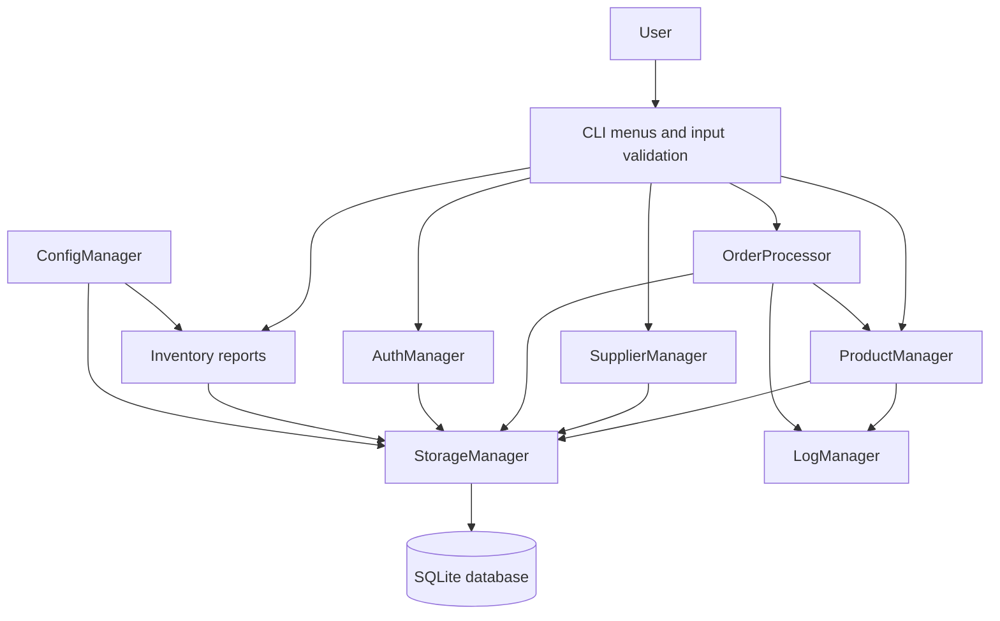
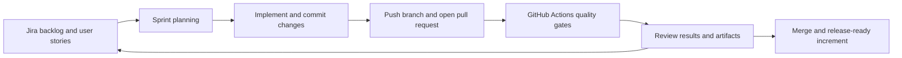
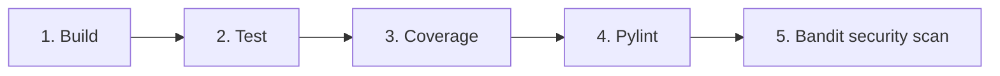

# IdeaForge Inventory Control Suite


## Project Overview

Inventory Management System (IMS) is a collaborative software engineering project built in Python to manage products, suppliers, stock movement, orders, auth, reporting, and audit logging through a command-line interface. The project was designed to reflect a real software team workflow involving feature planning, sprint execution, version control, code review, testing, and CI validation.

The application includes core inventory operations such as product CRUD, supplier management, purchase and sales orders, low-stock alerts, and report generation. It also demonstrates secure authentication, role-based access, and a structured SQLite-based data layer. In addition to development, the project emphasizes software quality through automated tests, coverage analysis, linting, and security scanning in GitHub Actions.

This repository was developed as a PES University Software Engineering course project and is being prepared for publication in the [PESU Technology GitHub repository](https://github.com/pestechnology/PESU_RR_CSE_H_P59_Command_line_based_Inventory_Management_Idea-Forge).

## Why this project stands out

- Built in a team-based Agile workflow using Jira, GitHub, and sprint planning
- Covers the full SDLC from requirements and design to implementation and validation
- Shows practical experience in Python development, database design, testing, and CI/CD
- Demonstrates software quality practices using pytest, coverage, Pylint, and Bandit
- Suitable for placement interviews and portfolio presentation as a real-world engineering project

## Portfolio Snapshot

| Area | Work demonstrated |
|---|---|
| Application development | Python CLI, modular architecture, SQLite persistence, validation, and business logic |
| Software testing | Unit, integration, and system testing with pytest; 331 tests pass locally |
| Quality engineering | Coverage analysis, Pylint, Bandit security scanning, and CI artifacts |
| DevOps | Five-stage GitHub Actions pipeline for build, test, coverage, lint, and security |
| Project management | Jira backlog, sprint tracking, priorities, role assignment, and burndown monitoring |
| SDLC | Requirements, architecture, implementation, verification, and retrospective documentation |
| Collaboration | Team-based contributions, Git branching, pull requests, feature ownership, and code review |

## Team Roles and Responsibilities

This project was delivered as a team effort, following a realistic software development structure. Each member contributed to different parts of the application workflow based on feature ownership and sprint priorities.

| Team role | Responsibilities |
|---|---|
| Product and inventory features | Product creation, viewing, searching, updates, stock management, and report generation |
| Supplier and purchasing workflow | Supplier handling, purchase orders, stock increase flow, and validation |
| Sales and order processing | Sales order logic, stock reduction, validation, and order workflow testing |
| Authentication and security | Login, admin access, user validation, password hashing, and authorization checks |
| Logging and audit control | Log generation, audit review, and admin monitoring for key events |
| Quality assurance and verification | Test design, regression checks, validation of edge cases, and quality gate review |
| Project coordination | Jira planning, backlog organization, sprint tracking, task assignment, and team delivery alignment |

This structure reflects how actual software teams divide work across product, quality, backend logic, and delivery management.

## Key Features

- Product management: add, view, search, update, delete, and stock adjustments
- Supplier management: create, view, and maintain supplier records
- Sales order processing with stock validation and quantity checks
- Purchase order processing with supplier linkage and stock updates
- Inventory reporting with totals, category analysis, stock value, and low-stock detection
- Role-based authentication and admin-only protected actions
- Audit logs and deletion confirmations for important operations
- SQLite-backed persistence with automatic database initialization
- Notification of low-stock conditions using the configured threshold
- Exportable inventory reports for review and documentation

## Technology Stack and Tools

### Application stack

- **Language:** Python 3.10+
- **User interface:** Menu-driven command-line interface
- **Database:** SQLite with parameterized SQL queries
- **Security libraries:** `hashlib` for salted SHA-256 password hashing and `cryptography` for Fernet key handling
- **Configuration:** Centralized paths and low-stock settings in `src/config.py`

### Development and quality tools

| Tool | Purpose |
|---|---|
| Git | Version control, branching, commits, merging, and change history |
| GitHub | Remote repository, pull requests, collaboration, and project visibility |
| Jira | Backlog, user stories, sprint planning, priorities, assignees, burndown, and reports |
| pytest | Automated unit, integration, and system testing |
| pytest-cov / coverage | Coverage measurement and HTML/XML coverage reports |
| Pylint | Static analysis and code-quality checks |
| Bandit | Python security scanning |
| GitHub Actions | Automated CI/CD pipeline on pushes and pull requests |
| VS Code | Development and test execution environment |

## Architecture

The application follows a small layered design. The CLI coordinates user interaction, managers implement business rules, and the storage layer owns SQLite persistence.



### Source modules

- `src/cli.py` - menus, prompts, navigation, and formatted terminal output.
- `src/storage.py` - SQLite schema, persistence, queries, and order records.
- `src/product_manager.py` - product CRUD, validation, stock, alerts, and reports.
- `src/supplier_manager.py` - supplier operations and search/update flows.
- `src/order_processor.py` - sales and purchase order workflows.
- `src/auth.py` - login, logout, password hashing, registration, and admin checks.
- `src/logger.py` - audit log creation, filtering, and display.
- `src/config.py` - database, backup, report, encryption-key, and threshold settings.
- `src/backup_security.py` - reserved interface for future backup/security implementation.

## SDLC and Agile Practices

This project was developed using a practical Software Development Life Cycle that mirrors a real software team environment:

1. **Requirements:** functional and non-functional requirements were captured in the SRS documentation.
2. **Design:** system architecture and component decisions were documented in the SAD documentation.
3. **Planning:** work was split into user stories, sprint items, and team responsibilities using Jira.
4. **Implementation:** features were developed as modular Python components with SQLite persistence.
5. **Verification:** automated tests, coverage checks, linting, and security scanning were added to the workflow.
6. **Collaboration and review:** team members coordinated through GitHub pull requests, task ownership, review discussions, and integrated delivery.
7. **Improvement:** sprint progress, burndown, workload, and retrospective outcomes were reviewed to improve team performance.



The Jira work included sprint boards, priorities, assignees, workload distribution, and burndown charts. These artifacts show how the team planned and monitored delivery in a real project environment rather than working only from the final code.

## Jira Project Tracking

Jira was used as the primary project tracking tool for this inventory management system. The project board represented the real software development workflow from backlog to completion and reflected how the team operated as a collaborative engineering unit.

### Jira activities performed

- Created and prioritized user stories and tasks for inventory features.
- Assigned work to team members based on feature ownership and sprint responsibilities.
- Managed sprint progress using board columns such as backlog, in progress, review, and done.
- Tracked issue status, assignees, priority, and delivery progress.
- Monitored sprint health using burndown and workload reporting.
- Reviewed completed work at the end of each sprint and documented outcomes.
- Coordinated the team around delivery goals in a realistic Agile sprint process.

### Example Jira workflow used

```text
Backlog -> To Do -> In Progress -> In Review -> Done
```

This demonstrates Agile delivery and showed how the project moved through real development cycles in a team-based, software-engineering workflow instead of being completed in a single pass.

## Testing

This project used both automated and manual testing as part of a realistic software quality process in a team-based development environment.

### Testing strategy

| Testing type | Method | Purpose |
|---|---|---|
| Automated testing | GitHub Actions + pytest | Run tests on every push/PR and validate code quality automatically |
| Manual testing | CLI validation and real-user interaction | Test usability, workflows, prompts, business logic, and edge cases in the running app |
| Regression testing | Re-run test suite after changes | Confirm previous functionality still works |
| Exploratory testing | Manual checks on main workflows | Validate that the application behaves correctly from a user perspective |

### Automated testing details

Testing is organized by scope:

| Test level | Location | Discovered tests | Purpose |
|---|---|---:|---|
| Unit | `tests/unit/` | 296 | Validate individual managers, storage operations, authentication, configuration, logging, CLI helpers, and business rules |
| Integration | `tests/integration/` | 34 | Validate workflows across multiple modules, including reports, products, and suppliers |
| System | `tests/system/` | 1 | Verify the application at a broader system level |
| **Total** | `tests/` | **331** | Full automated test suite |

### Verified local result

The complete suite was executed from the project root with the checked-in virtual environment:

```text
331 passed in 43.36s
```

Run the tests yourself with:

```bash
# All tests
python -m pytest

# By test level
python -m pytest tests/unit -v
python -m pytest tests/integration -v
python -m pytest tests/system -v

# Coverage reports
python -m pytest --cov=src --cov-report=term --cov-report=html tests/
```

The tests cover successful paths, invalid input, duplicate records, missing records, authorization failures, insufficient stock, deletion confirmation, report calculations, audit logs, and cross-module workflows.

### Manual testing performed

Manual testing was also done to validate the real application behavior in the CLI interface. This included the following checks:

- Login and logout flows for admin and regular users.
- Add, update, delete, and search product operations.
- Supplier management operations.
- Sales and purchase order creation.
- Stock reduction and stock increase after order processing.
- Inventory report generation and low-stock alerts.
- Admin-only restriction checks for sensitive actions.
- Error handling for invalid inputs and negative values.
- Review of log entries and confirmation prompts.

This is important because automation verifies code behavior, while manual testing verifies whether the application feels correct and usable from a real user perspective.

## GitHub Actions CI/CD

The workflow is defined in `.github/workflows/ci.yml` and runs on every branch push and on pull requests targeting `main`.

> These GitHub Actions jobs are automated validation jobs. They are not manual testing. Manual testing is performed separately during QA validation in the running CLI and is documented in the testing strategy above.



| Stage | What it does | Quality gate / output |
|---|---|---|
| Build | Uses Ubuntu and Python 3.10; installs dependencies; verifies the project structure | Dependencies install successfully |
| Test | Runs all unit, integration, and system tests | Test results uploaded as `test-results` |
| Coverage | Runs pytest-cov across `src/` | Minimum configured threshold: 74%; HTML and XML reports uploaded |
| Lint | Runs Pylint on all source modules | Minimum configured score: 7.5/10; report uploaded |
| Security | Runs Bandit recursively on `src/` | No high-severity findings; report uploaded |

The screenshot and PR check confirm that all five workflow stages passed successfully. These are automated CI jobs that validate code correctness after each push or pull request. Manual testing was done separately for real-world usage validation and QA review.

The pipeline produces reviewable artifacts for test results, HTML/XML coverage, Pylint, and Bandit. The local test result above is the current verified result; GitHub Actions results should be checked in the Actions tab after each push or pull request.

Run the quality tools locally:

```bash
python -m pytest --cov=src --cov-report=term --cov-report=html tests/
pylint src/
bandit -r src/
```

## Git and GitHub Workflow

The intended collaboration workflow is:

```bash
git clone https://github.com/pestechnology/PESU_RR_CSE_H_P59_Command_line_based_Inventory_Management_Idea-Forge.git
cd PESU_RR_CSE_H_P59_Command_line_based_Inventory_Management_Idea-Forge

git checkout -b feature/<short-feature-name>
git add .
git commit -m "Add <feature or test description>"
git push -u origin feature/<short-feature-name>
```

After pushing a branch, open a pull request to `main`, review the code and CI artifacts, address feedback, and merge only when the quality gates pass. Useful commands for review are:

```bash
git status
git log --oneline --decorate --graph --all
git diff main...HEAD
git pull --rebase origin main
```

The public project destination is:

- **Repository:** [pestechnology/PESU_RR_CSE_H_P59_Command_line_based_Inventory_Management_Idea-Forge](https://github.com/pestechnology/PESU_RR_CSE_H_P59_Command_line_based_Inventory_Management_Idea-Forge)

## Setup and Usage

### Prerequisites

- Python 3.10 or newer
- pip
- Git

### Install

```bash
python -m venv .venv

# Windows PowerShell
.\.venv\Scripts\Activate.ps1

# Linux/macOS
source .venv/bin/activate

python -m pip install --upgrade pip
pip install -r requirements.txt
pip install -r requirements-dev.txt
```

### Run the application

```bash
python src/cli.py
# or
python -m src.cli
```

On first run, SQLite tables are created under `data/` and a default admin account is seeded:

```text
Username: admin
Password: admin123
```

These credentials are for demonstration only and should be changed before real deployment.

## Repository Structure

```text
.
├── .github/workflows/ci.yml       # GitHub Actions pipeline
├── data/                           # Local SQLite database and key material
├── docs/                           # CI, SRS, SAD, test plan, and retrospective documents
├── scripts/package_deploy.sh       # Packaging/deployment placeholder script
├── src/                            # Application source code
├── tests/                          # Unit, integration, and system tests
├── conftest.py                     # Pytest import configuration
├── pytest.ini                      # Test discovery and coverage settings
├── requirements.txt                # Runtime and quality-tool dependencies
└── README.md                       # Project and engineering documentation
```

## Project Documentation and Diagrams

The `docs/` folder contains the supporting SDLC artifacts used during the project:

- `IdeaForge-SRS.docx` - Software Requirements Specification.
- `IdeaForge_SAD.docx` - Software Architecture/Design documentation.
- `Software_Test_Plan_IMS.docx` - test strategy and test planning.
- `Retrospective.docx` - Agile retrospective outcomes.
- `CMD_INVENTORY_MANAGEMENT_SYSTEM.pptx` - project presentation and visual diagrams.
- `README_CI.md` - detailed CI/CD stage documentation.

The Mermaid diagrams in this README provide a GitHub-rendered overview of the application architecture and Agile/CI delivery flow. The detailed diagrams and project visuals remain in the source documents above.

## Key Achievements

- Delivered a complete inventory management workflow covering products, suppliers, stock movement, and reporting
- Implemented secure authentication and admin-only controls for sensitive operations
- Built a modular and testable Python architecture for real-world software development
- Applied Agile delivery practices using Jira, sprint planning, and team coordination
- Integrated CI/CD quality gates through GitHub Actions for testing, coverage, linting, and security
- Verified the project with an automated suite of 331 passing tests

## Learning Outcome

This project strengthened practical understanding of software engineering in a team environment, covering requirement handling, sprint planning, implementation, testing, collaboration, and quality assurance. It also improved hands-on experience with Git workflows, CI automation, and project tracking tools used in modern software teams.

## Current Scope and Future Work

- Backup and restore menu wiring exists, while `BackupManager` and `SecurityManager` remain extension points for future implementation.
- The application is intended for local/course demonstration and is not a production deployment.
- Future improvements can include stronger password storage such as a dedicated password-hashing algorithm, environment-managed secrets, completed backup encryption/restore, deployment automation, and additional performance tests.

## Team Contribution Areas

The course project divided work across feature areas including product management, stock and purchase flows, product viewing and sales flows, supplier management, audit logging, deletion confirmation, and low-stock alerts. Jira was used to assign and monitor those work items across sprints, closely reflecting how a real software engineering team collaborates on a shared product backlog and delivery plan.

## License

See [LICENSE](LICENSE) for the project license.
